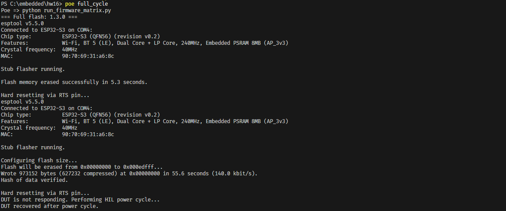
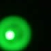

# Bug Reports — Firmware 1.3.0

**Test environment:** ESP32-S3 Smart Lamp DUT; UART / pytest / HIL automation; HIL camera and button/relay sensing.
**Detected on:** FW `1.3.0` (firmware stage in the latest supplied matrix run).  
**Test date:** 2026-10-21 (date the run was supplied; the console extract itself does not give wall-clock start time).  
**Evidence source:** latest pytest firmware-matrix output; suite **14 failed, 66 passed, 13 skipped, 8 deselected**; separate post-flash boot observation shown in `screenshots/flashing.png`.
**Reproducibility:** `1/1` in the supplied run for each listed failed parameter/case; the post-flash startup issue is documented in one screenshot, without a confirmed rerun rate.  
**Hardware revision / firmware build ID:** ESP32-S3 platform known; exact board revision and build identifiers not present in this run excerpt.  

> **Note:** Existing `BUG-*` IDs are retained. Regression issues use `REGRESSION-*` IDs. Classification does not by itself establish a firmware root cause. Severity/priority are proposals, not approved classifications. A pytest FAILED case is not automatically a firmware bug. HIL media can be overwritten across runs; a named file without a firmware identifier does not by itself prove the capture originated in this exact stage.

## BUG-BOOT-001 — Firmware 1.3.0 does not start responding after flashing until the device is rebooted

| Field | Details |
|---|---|
| **ID** | `BUG-BOOT-001` |
| **Title** | Firmware 1.3.0 is unresponsive after flashing and requires an additional reboot/power cycle |
| **Found in** | `1.3.0` |
| **Other firmware stages in this run** | `1.4.0`: Not tested for this post-flash scenario; `1.5.0`: Not tested for this post-flash scenario |
| **Severity / Priority** | **Major / High** (proposed) |
| **Requirement(s)** | Post-flash startup/readiness; no specific FR/NFR ID established from the provided materials |
| **Test Case ID** | Not assigned — observed during full firmware flashing before pytest execution |
| **Automated test / script** | `flash_device.py`, invoked by `run_firmware_matrix.py` through `poe full_cycle` |
| **Category** | Post-flash startup defect; root cause not yet isolated |
| **Reproducibility** | **One documented occurrence** in the supplied screenshot; repeatability not established |

**Preconditions**

- ESP32-S3 Smart Lamp DUT; target firmware `1.3.0`.
- Full flashing procedure available through `poe full_cycle` / `flash_device.py`.
- HIL controller can power-cycle the DUT.

**Steps to reproduce**

1. Perform a full flash of firmware `1.3.0` using `poe full_cycle` (which invokes `flash_device.py`).
2. Allow the flashing process to finish and `esptool` to perform its normal `Hard resetting via RTS pin...` step.
3. Without manually rebooting the device, attempt to communicate with it through the UART console (`help` is used by `flash_device.py` to check readiness).
4. Observe that the DUT does not become responsive during the initial readiness check.
5. Reboot/power-cycle the device and repeat the readiness check.

**Expected result:** After successful flashing and the normal programmer-triggered reset, the DUT starts firmware `1.3.0` and responds to UART commands without requiring any additional manual reboot or power cycle.

**Actual result:** Flash write and verification complete, but the DUT remains unresponsive during the post-flash readiness check. An additional reboot/power cycle is required; the DUT responds afterward. The project's flashing script recovers automatically through the HIL power-cycle fallback.

**Evidence — flashing console screenshot**

```text
=== Full flash: 1.3.0 ===
...
Hash of data verified.
Hard resetting via RTS pin...
DUT is not responding. Performing HIL power cycle...
DUT recovered after power cycle.
```



[Open full flashing screenshot](screenshots/flashing.png)

**UART logs:** Not available. The evidence is the flashing-script console output and the reported requirement to reboot the DUT before it works.

**Note:** The console screenshot confirms a post-flash responsiveness failure and successful recovery after a power cycle. It does not establish the internal reason for the stall or distinguish a firmware boot issue from reset sequencing / flashing-tool behavior. No regression classification is assigned without evidence that this exact scenario passed on another firmware version. This issue is separate from the pytest failure counts below.

---

## BUG-OTA-001 — OTA retry is blocked after Wi-Fi interruption via K3

| Field | Details |
|---|---|
| **ID** | `BUG-OTA-001` |
| **Title** | OTA retry is blocked after Wi-Fi interruption via K3 |
| **Found in** | `1.3.0` |
| **Other firmware stages in this run** | `1.4.0`: Not observed (test not in FAILED list), `1.5.0`: Skipped — no newer firmware |
| **Severity / Priority** | **Major / High** |
| **Requirement(s)** | **OTA-6**, **FR-W5** |
| **Test Case ID** | `TC-OTA-012` |
| **Automated test** | `tests/ota/test_04_interrupt.py::test_ota_interrupt_wifi_by_k3_button` |
| **Category** | Candidate firmware defect |
| **Reproducibility** | **1 failed pytest case(s) in 1 supplied run**; no independent rerun count |

**Preconditions**

- FW 1.3.0 in `valid` state; active Wi-Fi; firmware 1.4.0 available on OTA server.
- HIL K3 button can disconnect Wi-Fi during a download.

**Steps to reproduce**

1. Start `ota install 1.4.0` and wait for `[OTA] progress: 10%`.
2. Press K3; wait for the OTA interruption and verify the current partition/version remain unchanged.
3. Restore Wi-Fi; **without rebooting DUT**, run `ota install 1.4.0` again.

**Expected result:** After reconnection, OTA state is reset and a fresh attempt can start and finish without DUT reboot.

**Actual result:** A new attempt is rejected with `[OTA] error: update already in progress`.

**Evidence — UART / pytest**

```text
ota install 1.4.0
E (14428) wifi station: [OTA] error: update already in progress
AssertionError: OTA retry failed
```


**Photo/video:** No direct image/video artifact for this UART-based failure in the supplied project.

**Note:** The failed retry is directly observed. The excerpt does not contain all logs from the first interruption; timing/cleanup causality should be confirmed with an additional instrumented run.

---

## BUG-OTA-002 — `ota-test-server` reports no-Wi-Fi error without the expected `[OTA]` prefix

| Field | Details |
|---|---|
| **ID** | `BUG-OTA-002` |
| **Title** | `ota-test-server` reports no-Wi-Fi error without the expected `[OTA]` prefix |
| **Found in** | `1.3.0` |
| **Other firmware stages in this run** | `1.4.0`: Observed, `1.5.0`: Observed |
| **Severity / Priority** | **Minor / Medium** |
| **Requirement(s)** | **OTA-7**, **OTA-12** |
| **Test Case ID** | `TC-OTA-014` |
| **Automated test** | `tests/ota/test_05_no_wifi.py::test_ota_without_wifi[ota-test-server]` |
| **Category** | Firmware CLI contract / automation parser mismatch |
| **Reproducibility** | **1 failed pytest case(s) in 1 supplied run**; no independent rerun count |

**Preconditions**

- DUT has no active Wi-Fi; UART console reachable.
- No OTA download is in progress.

**Steps to reproduce**

1. Check that the DUT is disconnected from Wi-Fi.
2. Execute `ota-test-server` via the test/controller.
3. Compare the response to the expected OTA error-message contract.

**Expected result:** The command should reject promptly with `[OTA] failed: WiFi not connected. Use 'connect' first.` (the contract currently encoded in the test/checklist).

**Actual result:** DUT does reject the operation, but emits `OTA failed:` without `[OTA]`. The controller waits 30 seconds for the prefixed form and raises `DeviceTimeoutError`.

**Evidence — UART / pytest**

```text
ota-test-server
E (961) wifi station: OTA failed: WiFi not connected. Use 'connect' first.
DeviceTimeoutError: Expected response ("[OTA] failed: WiFi not connected. Use 'connect' first.", ...) was not received within 30s.
```


**Photo/video:** No direct image/video artifact for this UART-based failure in the supplied project.

**Note:** Missing Wi-Fi rejection behavior works; the observed discrepancy is **format**, not failure to block OTA. Confirm whether the exact prefix is part of firmware requirements; otherwise change the parser rather than claiming a firmware defect.

---

## BUG-OTA-003 — OTA stays locked after an invalid image is rejected

| Field | Details |
|---|---|
| **ID** | `BUG-OTA-003` |
| **Title** | OTA stays locked after an invalid image is rejected |
| **Found in** | `1.3.0` |
| **Other firmware stages in this run** | `1.4.0`: Not observed (test not in FAILED list), `1.5.0`: Observed |
| **Severity / Priority** | **Major / High** |
| **Requirement(s)** | **OTA-11** and recovery expectation |
| **Test Case ID** | `TC-OTA-022` (follow-up/retry scenario) |
| **Automated test** | `tests/ota/test_08_invalid_image.py::test_ota_install_after_invalid_image` |
| **Category** | Candidate firmware OTA cleanup defect |
| **Reproducibility** | **1 failed pytest case(s) in 1 supplied run**; no independent rerun count |

**Preconditions**

- Wi-Fi connected; active image `valid`.
- An invalid-header image matching the current firmware version is configured.

**Steps to reproduce**

1. Run `ota <invalid_header_url>`.
2. Confirm invalid image rejection (`ESP_ERR_OTA_VALIDATE_FAILED`).
3. Without rebooting, run `ota install <current_version> force`.
4. Check whether a valid installation can start.

**Expected result:** Invalid image is rejected and the OTA worker becomes idle; immediate valid retry is accepted without reboot.

**Actual result:** After the rejection, a valid force reinstall is rejected as already in progress.

**Evidence — UART / pytest**

```text
ota install 1.3.0 force
E (7241) wifi station: [OTA] error: update already in progress
AssertionError: OTA remained locked after invalid image
```


**Photo/video:** No direct image/video artifact for this UART-based failure in the supplied project.

**Note:** The test asserts `ESP_ERR_OTA_VALIDATE_FAILED` before this retry. A valid 1.3.0 force reinstall is then refused without a reboot.

---

## BUG-LAMP-001 — Physical LED colors differ from named and explicit RGB commands

| Field | Details |
|---|---|
| **ID** | `BUG-LAMP-001` |
| **Title** | Physical LED colors differ from named and explicit RGB commands |
| **Found in** | `1.3.0` |
| **Other firmware stages in this run** | `1.4.0`: Not observed (test not in FAILED list), `1.5.0`: Not observed (test not in FAILED list) |
| **Severity / Priority** | **Major / High (proposed)** |
| **Requirement(s)** | **FR-L2**, **FR-L3**, **FR-L4** |
| **Test Case ID** | `TC-LAMP-004`, `TC-LAMP-006` |
| **Automated test** | `tests/lamp/test_02_lamp_named_colors.py::test_set_named_color` (4 parameters); `tests/lamp/test_03_lamp_rgb.py::test_set_rgb_color` (4 parameters) |
| **Category** | Physical output mismatch; cause not isolated |
| **Reproducibility** | **8 failed pytest case(s) in 1 supplied run**; no independent rerun count |

**Preconditions**

- FW 1.3.0; lamp on; camera ROI aligned with the same physical LED.
- Controlled lighting, camera capture and color mapping as configured in the HIL.

**Steps to reproduce**

1. Set red/green/purple/cyan by name and red/green/violet/purple by explicit RGB.
2. Verify UART response and lamp state.
3. Capture the LED using `hil.camera.photo.verify` and compare observed and expected HSV.

**Expected result:** LED color matches the requested RGB value for every tested case.

**Actual result:** Eight parameterizations time out; examples: named red expected HSV `(0,255,255)` but actual `(63,248,150)`, and named green expected `(60,255,255)` but actual `(6,239,161)`.

**Evidence — UART / pytest**

```text
test_set_named_color[red_255_0_0]
TimeoutError: Lamp did not reach RGB (255, 0, 0).
Expected HSV: (0, 255, 255), actual HSV: (63, 248, 150).

test_set_named_color[green_0_255_0]
TimeoutError: Lamp did not reach RGB (0, 255, 0).
Expected HSV: (60, 255, 255), actual HSV: (6, 239, 161).
```


**Photo evidence — HIL camera (`artifacts/camera/failed/`):**

| Test / color | Expected HSV | Actual HSV | Debug frame | ROI |
|---|---|---|---|---|
| Named red | `(0, 255, 255)` | `(63, 248, 150)` | [Debug](../../camera/failed/red_255_0_0_debug.jpg) | [ROI](../../camera/failed/red_255_0_0_roi.jpg) |
| Named green | `(60, 255, 255)` | `(6, 239, 161)` | [Debug](../../camera/failed/green_0_255_0_debug.jpg) | [ROI](../../camera/failed/green_0_255_0_roi.jpg) |
| Named purple | `(139, 255, 255)` | `(87, 243, 151)` | [Debug](../../camera/failed/purple_160_0_255_debug.jpg) | [ROI](../../camera/failed/purple_160_0_255_roi.jpg) |
| Named cyan | `(90, 255, 255)` | `(149, 142, 134)` | [Debug](../../camera/failed/cyan_0_255_255_debug.jpg) | [ROI](../../camera/failed/cyan_0_255_255_roi.jpg) |
| RGB red | `(0, 255, 255)` | `(64, 234, 213)` | [Debug](../../camera/failed/rgb_red_255_0_0_debug.jpg) | [ROI](../../camera/failed/rgb_red_255_0_0_roi.jpg) |
| RGB green | `(60, 255, 255)` | `(8, 255, 128)` | [Debug](../../camera/failed/rgb_green_0_255_0_debug.jpg) | [ROI](../../camera/failed/rgb_green_0_255_0_roi.jpg) |
| RGB violet | `(135, 170, 192)` | `(96, 177, 182)` | [Debug](../../camera/failed/rgb_violet_128_64_192_debug.jpg) | [ROI](../../camera/failed/rgb_violet_128_64_192_roi.jpg) |
| RGB purple | `(130, 191, 200)` | `(98, 214, 139)` | [Debug](../../camera/failed/rgb_purple_100_50_200_debug.jpg) | [ROI](../../camera/failed/rgb_purple_100_50_200_roi.jpg) |


**Note:** Eight case failures in one run are not eight separate root-cause bugs. HIL photos corroborate physical mismatch; firmware LED mapping, wiring and camera calibration require differential checking.

---

## BUG-LAMP-002 — Wi-Fi disconnected LED indication is not red after `lamp off`

| Field | Details |
|---|---|
| **ID** | `BUG-LAMP-002` |
| **Title** | Wi-Fi disconnected LED indication is not red after `lamp off` |
| **Found in** | `1.3.0` |
| **Other firmware stages in this run** | `1.4.0`: Observed, `1.5.0`: Observed |
| **Severity / Priority** | **Major / Medium (proposed)** |
| **Requirement(s)** | **FR-W6**, **FR-L1** / lamp-vs-Wi-Fi LED ownership |
| **Test Case ID** | `TC-LAMP-036` |
| **Automated test** | `tests/lamp/test_11_lamp_wifi_indication.py::test_wifi_disconnected_indication_is_restored_after_lamp_off` |
| **Category** | Physical LED indication mismatch |
| **Reproducibility** | **1 failed pytest case(s) in 1 supplied run**; no independent rerun count |

**Preconditions**

- DUT Wi-Fi is disconnected and `has_active_wifi_connection` is false.
- LED is configured to `auto`; lamp is set blue at brightness 50%, mode `solid`, and switched on.

**Steps to reproduce**

1. Call `led.auto()` and configure/enable the lamp.
2. Confirm Wi-Fi remains disconnected.
3. Execute `lamp off` and confirm state says lamp off.
4. Capture the physical LED color.

**Expected result:** After lamp off, disconnected Wi-Fi indication is red (`RGB 255,0,0`, expected HSV `(0,255,255)`).

**Actual result:** Camera detects a green/yellow-green color rather than red; HIL color verification times out.

**Evidence — UART / pytest**

```text
TimeoutError: Lamp did not reach RGB (255, 0, 0).
Expected HSV: (0, 255, 255), actual HSV: (64, 236, 179).
```


**Photo evidence — HIL camera:**



[Debug frame](../../camera/failed/wifi_disconnected_indication_after_lamp_off_255_0_0_debug.jpg) · [ROI image](../../camera/failed/wifi_disconnected_indication_after_lamp_off_255_0_0_roi.jpg)

*Media caveat:* The shared HIL filenames are overwritten/reused across firmware suites; their source firmware cannot be determined from the filenames alone.

**Note:** The same failed scenario occurs on all three firmware stages of the supplied run. The shared media filename is reused by HIL and does **not** encode firmware; it is visual evidence of the scenario, not proof of which per-version run generated the last saved file.

---

## BUG-LAMP-003 — Out-of-range lamp brightness values are accepted

| Field | Details |
|---|---|
| **ID** | `BUG-LAMP-003` |
| **Title** | Out-of-range lamp brightness values are accepted |
| **Found in** | `1.3.0` |
| **Other firmware stages in this run** | `1.4.0`: Not observed (test not in FAILED list), `1.5.0`: Not observed (test not in FAILED list) |
| **Severity / Priority** | **Minor / Medium** |
| **Requirement(s)** | **FR-L5** |
| **Test Case ID** | `TC-LAMP-011` |
| **Automated test** | `tests/lamp/test_04_lamp_brightness.py::test_reject_brightness_outside_range[-5]` and `[150]` |
| **Category** | Firmware input-validation defect |
| **Reproducibility** | **2 failed pytest case(s) in 1 supplied run**; no independent rerun count |

**Preconditions**

- FW 1.3.0; UART available; lamp enabled with known initial brightness.

**Steps to reproduce**

1. Send `lamp brightness -5`.
2. Check for validation error and unchanged brightness.
3. Send `lamp brightness 150`; repeat the check.

**Expected result:** Both values are rejected with `error: brightness must be 0-100`; stored brightness remains unchanged.

**Actual result:** DUT reports successful acceptance of both invalid values.

**Evidence — UART / pytest**

```text
lamp brightness -5
I (5009) wifi station: [LAMP] brightness set: -5%
lamp brightness 150
I (5809) wifi station: [LAMP] brightness set: 150%
```


**Photo/video:** No direct image/video artifact for this UART-based failure in the supplied project.

**Note:** The supplied failure output proves incorrect success responses; it does not by itself establish the final persisted brightness values.

---

## Summary

| Issue ID | Area / symptom | Number of FAILED cases | Classification |
|---|---|---:|---|
| `BUG-BOOT-001` | Post-flash firmware 1.3.0 unresponsive until reboot/power cycle | 0 (separate flashing observation) | Post-flash startup; root cause not isolated |
| `BUG-OTA-001` | OTA retry is blocked after Wi-Fi interruption via K3 | 1 | Candidate firmware defect |
| `BUG-OTA-002` | `ota-test-server` reports no-Wi-Fi error without the expected `[OTA]` prefix | 1 | Firmware CLI contract / automation parser mismatch |
| `BUG-OTA-003` | OTA stays locked after an invalid image is rejected | 1 | Candidate firmware OTA cleanup defect |
| `BUG-LAMP-001` | Physical LED colors differ from named and explicit RGB commands | 8 | Physical output mismatch; cause not isolated |
| `BUG-LAMP-002` | Wi-Fi disconnected LED indication is not red after `lamp off` | 1 | Physical LED indication mismatch |
| `BUG-LAMP-003` | Out-of-range lamp brightness values are accepted | 2 | Firmware input-validation defect |

**Total: 7 issue records — 6 issues accounting for all 14 FAILED pytest cases, plus 1 separately observed post-flash startup issue (`BUG-BOOT-001`).** The post-flash issue does not change the pytest totals. These are observations, not confirmed unique root causes.

## Full-run screenshots

The screenshots are included as run context, not substitutes for the quoted UART/HIL evidence.

- [Regression 1.3.0 screenshot 1](screenshots/regression%201.3.0%20%281%29.png)
- [Regression 1.3.0 screenshot 2](screenshots/regression%201.3.0%20%282%29.png)
- [Regression 1.3.0 screenshot 3](screenshots/regression%201.3.0%20%283%29.png)


## Skipped tests (pytest summary)

- `SKIPPED [1] tests\lamp\test_05_lamp_modes.py:8: Requires firmware >= 1.5.0, current firmware is 1.3.0`
- `SKIPPED [3] tests\lamp\test_09_lamp_scenes.py:32: Requires firmware >= 1.5.0, current firmware is 1.3.0`
- `SKIPPED [1] tests\lamp\test_04_lamp_brightness.py:41: Requires firmware >= 1.5.0, current firmware is 1.3.0`
- `SKIPPED [1] tests\lamp\test_09_lamp_scenes.py:65: Requires firmware >= 1.5.0, current firmware is 1.3.0`
- `SKIPPED [1] tests\ota\test_06_persistence.py:115: Requires firmware >= 1.4.0, current firmware is 1.3.0`
- `SKIPPED [1] tests\ota\test_06_persistence.py:209: Requires firmware == 1.5.0, current firmware is 1.3.0`
- `SKIPPED [4] tests\lamp\test_09_lamp_scenes.py:91: Requires firmware >= 1.5.0, current firmware is 1.3.0`
- `SKIPPED [1] tests\ota\test_02_install.py:90: No older firmware available for 1.3.0`

**Evidence limitations:** Original raw video/photo capture timestamps and names are retained, but HIL filenames may be reused across firmware stages. No unsupported per-version media attribution or new hardware/build numbers are asserted.
