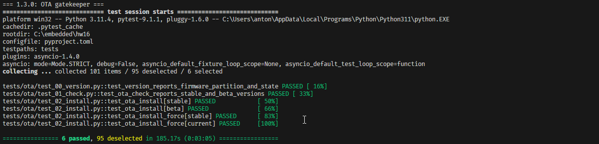

# Firmware Matrix — Full Cycle Test Report

**Project:** ESP32-S3 Smart Lamp + OTA (`hw16`)  
**Execution command:** `poe full_cycle` → `python run_firmware_matrix.py`  
**Firmware sequence:** `1.3.0` (full flash) → `1.4.0` (OTA) → `1.5.0` (OTA)  
**Test environment:** Windows / COM4, ESP32-S3 chip revision v0.2, Python 3.11.4, pytest 9.1.1, pytest-asyncio 1.4.0, UART and hardware-in-the-loop (HIL) camera/button/relay verification.  
**Evidence:** supplied full-cycle terminal output and the original screenshots in `screenshots/`.  
**Execution date:** not recorded in the supplied terminal output; related bug reports identify the run as October 21, 2026.  
**Scope:** automated Smart Lamp and OTA tests, including connected/disconnected Wi-Fi scenarios within those suites. A separate standalone Wi-Fi regression suite was not included in the provided project's `tests/` directory.

## 1. Executive summary

**Release recommendation: NO-GO — firmware 1.5.0 is NOT READY to be promoted from Beta to Stable.**

FW 1.5.0 demonstrates functional improvements over 1.3.0 (including `rainbow` mode and scenes), but it still has **8 failing tests** in the primary suite. Several failures affect expected behavior critical to a safe firmware release: scene persistence after OTA reinstall, the upgrade path retaining lamp settings (`1.4.0 → 1.5.0`), and recovery after an invalid OTA image. The `blink` brightness test is a credible version-specific regression (passes on 1.3.0 and 1.4.0, fails on 1.5.0). K2 relay output also fails HIL verification on both 1.4.0 and 1.5.0, although the firmware logs acknowledge the press.

**Additionally, dedicated testing of critical Wi-Fi functionality was not performed during this test cycle.** Wi-Fi connectivity is a core feature of the device and a fundamental dependency for OTA updates. Although Wi-Fi connectivity was exercised as part of OTA testing, this does not provide comprehensive coverage of Wi-Fi functionality. Consequently, **potential defects affecting Wi-Fi connection management, reconnection, credential persistence, and overall device operation may remain undetected**. This incomplete test coverage introduces additional release risk that is not reflected in the current test failure count.

**Firmware 1.5.0 must remain in Beta until the identified defects are resolved, all critical regressions are addressed, comprehensive Wi-Fi functional testing is completed, and a full regression suite passes successfully.**

### Main suite results

| Firmware | Passed | Failed | Skipped | Deselected | Executed pass rate¹ | Duration | Suite result |
|---|---:|---:|---:|---:|---:|---|---|
| **1.3.0** | 66 | 14 | 13 | 8 | 82.5% | 14m 55s | FAIL |
| **1.4.0** | 75 | 4 | 14 | 8 | 94.9% | 14m 35s | FAIL |
| **1.5.0** | 76 | 8 | 9 | 8 | 90.5% | 11m 25s | FAIL |
| **Total (main suites)** | **217** | **26** | **36** | **24** | **89.3%** | — | **FAIL** |

¹ `PASSED / (PASSED + FAILED)`; skipped and deselected tests are excluded from the pass rate. Counts are pytest **test cases/parameter instances**, not unique defects. The 8 deselected items per suite are handled by separate stages; do not add them to failures.

### Preliminary and special stages (reported separately)

| Stage | Passed | Failed | Skipped | Deselected | Result |
|---|---:|---:|---:|---:|---|
| 1.3.0 — clean-device defaults (`first`) | 1 | 0 | 1 | 99 | PASS, with version-gated skip |
| 1.3.0 — OTA gatekeeper | 6 | 0 | 0 | 95 | PASS |
| 1.5.0 — empty-scene validation | 1 | 0 | 0 | 0 | PASS |

The runner reports **101 collected items** in the normal pytest collection; each main suite executes 93 selected items (including skips), with 8 deselected. The preliminary stages rerun selected test cases and **must not be treated as additional unique test coverage**. Across all stage executions, pytest reports 225 passes, 26 failures and 37 skips, including preliminary stages.

## 2. Test execution and initial flashing

1. `poe full_cycle` erased and flashed FW 1.3.0 to the ESP32-S3 via esptool 5.5.0, with image hash verification.
2. **Post-flash startup problem:** after `Hard resetting via RTS pin...`, the DUT did not respond. The runner performed a **HIL power cycle** and reported `DUT recovered after power cycle`. This is documented separately as [BUG-BOOT-001](BUG_REPORTS_FW_1.3.0.md#bug-boot-001--firmware-130-does-not-start-responding-after-flashing-until-the-device-is-rebooted) and is **not included in the 14 pytest failures**.
3. The clean-device default-state check passed, and all **6 OTA gatekeeper tests passed**.
4. The runner executed each firmware's suite, updating between versions through OTA, and continued collecting failures instead of stopping after the first non-gatekeeper failure.
5. On 1.5.0, the dedicated empty-scene validation passed before the main suite.

*Figure 1 — Initial 1.3.0 flashing and HIL power-cycle recovery.*

*Figure 2 — Default state on clean FW 1.3.0.*

*Figure 3 — OTA gatekeeper: 6 passed.*

## 3. Firmware 1.3.0 — results and issues

**Main suite:** 66 passed / 14 failed / 13 skipped / 8 deselected.

| Issue | Requirement | Observed failure | Number of failing cases |
|---|---|---|---:|
| [BUG-LAMP-001](BUG_REPORTS_FW_1.3.0.md#bug-lamp-001--physical-led-colors-differ-from-named-and-explicit-rgb-commands) | FR-L2, FR-L3, FR-L4 | Named and RGB colors do not match camera measurements | 8 |
| [BUG-LAMP-002](BUG_REPORTS_FW_1.3.0.md#bug-lamp-002--wi-fi-disconnected-led-indication-is-not-red-after-lamp-off) | FR-W6 / FR-L1 | Red Wi-Fi indication is not restored after `lamp off` | 1 |
| [BUG-LAMP-003](BUG_REPORTS_FW_1.3.0.md#bug-lamp-003--out-of-range-lamp-brightness-values-are-accepted) | FR-L5 | Brightness values `-5` and `150` are accepted | 2 |
| [BUG-OTA-001](BUG_REPORTS_FW_1.3.0.md#bug-ota-001--ota-retry-is-blocked-after-wi-fi-interruption-via-k3) | OTA-6 | OTA retry blocked after K3-triggered Wi-Fi interruption | 1 |
| [BUG-OTA-002](BUG_REPORTS_FW_1.3.0.md#bug-ota-002--ota-test-server-reports-no-wi-fi-error-without-the-expected-ota-prefix) | OTA-7 / OTA-12 | `ota-test-server` no-Wi-Fi output lacks the expected `[OTA]` prefix | 1 |
| [BUG-OTA-003](BUG_REPORTS_FW_1.3.0.md#bug-ota-003--ota-stays-locked-after-an-invalid-image-is-rejected) | OTA-11 / OTA recovery | Valid OTA retry blocked after invalid-image rejection | 1 |
| [BUG-BOOT-001](BUG_REPORTS_FW_1.3.0.md#bug-boot-001--firmware-130-does-not-start-responding-after-flashing-until-the-device-is-rebooted) | OTA-9 (related) / PRD §2 | DUT requires HIL power cycle after full flash | Outside pytest |

**Version-gated skips:** primarily scenes and `rainbow` (available starting at 1.5.0), newer-version-only checks and unavailable downgrade targets. These are expected applicability skips rather than observed defects.

### Screenshots — FW 1.3.0

*Figure 4 — FW 1.3.0 suite (part 1).* 

*Figure 5 — FW 1.3.0 suite (part 2).* 

*Figure 6 — FW 1.3.0 skip reasons and failure count.*

## 4. Firmware 1.4.0 — results and issues

**Main suite:** 75 passed / 4 failed / 14 skipped / 8 deselected. This is the strongest result of the three main suites, although it is **not fully passing**.

| Issue | Requirement | Observed failure |
|---|---|---|
| [BUG-LAMP-002](BUG_REPORTS_FW_1.4.0.md#bug-lamp-002--wi-fi-disconnected-led-indication-is-not-red-after-lamp-off) | FR-W6 / FR-L1 | Wi-Fi disconnected indication remains physically incorrect after `lamp off` |
| [REGRESSION-OTA-004](BUG_REPORTS_FW_1.4.0.md#regression-ota-004--lamp-rgb-configuration-changes-to-white-after-ota-140--150) | OTA-8 / FR-L9 | During **1.4.0 → 1.5.0**, expected color `(12, 34, 56)` becomes `(255, 255, 255)` after update |
| [REGRESSION-HIL-001](BUG_REPORTS_FW_1.4.0.md#regression-hil-001--k2-relay-does-not-change-physical-hil-state-during-ota-although-dut-logs-relay-on) | OTA-5 / PRD §6 (K2) | DUT logs `[K2] relay ON`, but measured physical state remains OFF → OFF |
| [BUG-OTA-002](BUG_REPORTS_FW_1.4.0.md#bug-ota-002--ota-test-server-reports-no-wi-fi-error-without-the-expected-ota-prefix) | OTA-7 / OTA-12 | Same `ota-test-server` response-format/controller mismatch |

**Important attribution:** the settings-persistence failure is recorded in the **1.4.0 test stage**, but it occurred during installation of **1.5.0**. It is a **1.4.0 → 1.5.0 transition issue**, not proof that 1.4.0 itself causes the loss.

Other positive results include correct named/RGB colors, valid brightness range handling, and successful recovery after the invalid-image test. Feature availability and test applicability account for the 14 skips.

### Screenshots — FW 1.4.0

*Figure 7 — FW 1.4.0 suite (part 1).* 

*Figure 8 — FW 1.4.0 suite (part 2).* 

*Figure 9 — FW 1.4.0 skip reasons and failure count.*

## 5. Firmware 1.5.0 (Beta) — results and issues

**Main suite:** 76 passed / 8 failed / 9 skipped / 8 deselected.

**Positive coverage:** named/RGB colors, `rainbow` mode, saving/loading supported scenes, scene persistence across an ordinary reboot, OTA rollback, and invalid/corrupted-image **rejection** passed. These passes do not offset separate failures in OTA recovery and persistence.

| Issue | Requirement | Actual result / qualification |
|---|---|---|
| [REGRESSION-LAMP-004](BUG_REPORTS_FW_1.5.0.md#regression-lamp-004--blink-peak-brightness-differs-from-solid-brightness-on-fw-150-regression) | FR-L5 | `blink` measured 56.0 versus `solid` 23.0 at the same configured brightness (±10% expected); **passed on 1.3.0/1.4.0**; verify camera exposure comparability |
| [REGRESSION-LAMP-005](BUG_REPORTS_FW_1.5.0.md#regression-lamp-005--red-indicator-assertion-fails-after-auto-off-timer-expires-on-fw-150) | FR-L7 / FR-W6 | Timer-expiry test expected red LED, observed HSV `(32, 189, 173)`; **verify test Wi-Fi/LED preconditions** |
| [REGRESSION-LAMP-006](BUG_REPORTS_FW_1.5.0.md#regression-lamp-006--canceled-timer-test-observes-changing-led-color-on-fw-150) | FR-L7 | Canceled-timer test detected changing LED color; **test did not explicitly set `solid` mode** |
| [BUG-LAMP-002](BUG_REPORTS_FW_1.5.0.md#bug-lamp-002--wi-fi-disconnected-led-indication-is-not-red-after-lamp-off) | FR-W6 / FR-L1 | Wrong color for disconnected Wi-Fi indication after `lamp off`; affects all three FW versions |
| [REGRESSION-OTA-005](BUG_REPORTS_FW_1.5.0.md#regression-ota-005--scenes-disappear-after-force-reinstall-of-firmware-150) | OTA-8 / FR-L10 | After reinstalling 1.5.0, loading previously saved scene 1 reports `error: scene 1 is empty` |
| [REGRESSION-HIL-001](BUG_REPORTS_FW_1.5.0.md#regression-hil-001--k2-relay-does-not-change-physical-hil-state-during-ota-although-dut-logs-relay-on) | OTA-5 / PRD §6 (K2) | DUT acknowledges K2, HIL measures relay OFF → OFF; also fails on 1.4.0; HIL/relay localization required |
| [BUG-OTA-002](BUG_REPORTS_FW_1.5.0.md#bug-ota-002--ota-test-server-reports-no-wi-fi-error-without-the-expected-ota-prefix) | OTA-7 / OTA-12 | Missing `[OTA]` prefix on `ota-test-server` no-Wi-Fi error, causing controller timeout; also present on 1.3.0 and 1.4.0 |
| [BUG-OTA-003](BUG_REPORTS_FW_1.5.0.md#bug-ota-003--ota-stays-locked-after-an-invalid-image-is-rejected) | OTA-11 / OTA recovery | After invalid-image rejection, `ota install 1.5.0 force` reports `[OTA] error: update already in progress`; **1.4.0 passed this check** |

**Skips (9):** tests requiring firmware newer than 1.5.0 and tests applicable only to earlier versions. They are expected skips, not passes.

### Screenshots — FW 1.5.0

*Figure 10 — FW 1.5.0 special empty-scene test: passed.*

*Figure 11 — FW 1.5.0 suite (part 1).* 

*Figure 12 — FW 1.5.0 suite (part 2).* 

*Figure 13 — FW 1.5.0 skip reasons and failure count.*

## 6. Cross-version regression analysis

| Verification | FW 1.3.0 | FW 1.4.0 | FW 1.5.0 | Interpretation |
|---|---|---|---|---|
| `blink` brightness vs `solid` | PASS | PASS | FAIL | [REGRESSION-LAMP-004](BUG_REPORTS_FW_1.5.0.md#regression-lamp-004--blink-peak-brightness-differs-from-solid-brightness-on-fw-150-regression) — likely version-specific regression; confirm with controlled exposure |
| Lamp RGB after OTA upgrade | PASS (1.3→1.4) | FAIL (1.4→1.5) | Not applicable (no newer FW) | [REGRESSION-OTA-004](BUG_REPORTS_FW_1.4.0.md#regression-ota-004--lamp-rgb-configuration-changes-to-white-after-ota-140--150) — loss on upgrade to 1.5.0 |
| Scenes after reinstall | Not available | Not available | FAIL | [REGRESSION-OTA-005](BUG_REPORTS_FW_1.5.0.md#regression-ota-005--scenes-disappear-after-force-reinstall-of-firmware-150) — 1.5.0-specific feature persistence failure |
| OTA attempt after invalid-image rejection | FAIL | PASS | FAIL | [BUG-OTA-003](BUG_REPORTS_FW_1.5.0.md#bug-ota-003--ota-stays-locked-after-an-invalid-image-is-rejected) — defect reappears in 1.5.0 |
| K2 relay physical response during OTA | PASS | FAIL | FAIL | [REGRESSION-HIL-001](BUG_REPORTS_FW_1.5.0.md#regression-hil-001--k2-relay-does-not-change-physical-hil-state-during-ota-although-dut-logs-relay-on) — physical/HIL investigation needed |
| Wi-Fi disconnected indicator after lamp off | FAIL | FAIL | FAIL | [BUG-LAMP-002](BUG_REPORTS_FW_1.5.0.md#bug-lamp-002--wi-fi-disconnected-led-indication-is-not-red-after-lamp-off) — existing cross-version issue |
| `ota-test-server` no-Wi-Fi message | FAIL | FAIL | FAIL | [BUG-OTA-002](BUG_REPORTS_FW_1.5.0.md#bug-ota-002--ota-test-server-reports-no-wi-fi-error-without-the-expected-ota-prefix) — message contract / parser mismatch |
| Timer expiry / cancellation checks | PASS | PASS | FAIL | [REGRESSION-LAMP-005](BUG_REPORTS_FW_1.5.0.md#regression-lamp-005--red-indicator-assertion-fails-after-auto-off-timer-expires-on-fw-150), [REGRESSION-LAMP-006](BUG_REPORTS_FW_1.5.0.md#regression-lamp-006--canceled-timer-test-observes-changing-led-color-on-fw-150); validate test preconditions and mode isolation |

The classifications above reflect **observed cross-version test outcomes**. They should not override the root-cause caveats documented in each individual bug report.

## 7. Release readiness — FW 1.5.0 Beta → Stable

**Decision: NO-GO / REMAIN IN BETA.**

The following items must be resolved or conclusively dispositioned before Stable promotion:

1. **Protect persistent user settings:** resolve the `1.4.0 → 1.5.0` lamp RGB reset ([REGRESSION-OTA-004](BUG_REPORTS_FW_1.4.0.md#regression-ota-004--lamp-rgb-configuration-changes-to-white-after-ota-140--150)) and verify OTA-8/FR-L9 with representative saved settings.
2. **Preserve scenes across OTA:** resolve scene loss after a force reinstall ([REGRESSION-OTA-005](BUG_REPORTS_FW_1.5.0.md#regression-ota-005--scenes-disappear-after-force-reinstall-of-firmware-150)) and repeat OTA-8/FR-L10 scene-persistence checks.
3. **Recover OTA after failed validation:** resolve the OTA `already in progress` lock ([BUG-OTA-003](BUG_REPORTS_FW_1.5.0.md#bug-ota-003--ota-stays-locked-after-an-invalid-image-is-rejected)); verify a valid retry without a reboot after a rejected image.
4. **Verify brightness regression:** investigate [REGRESSION-LAMP-004](BUG_REPORTS_FW_1.5.0.md#regression-lamp-004--blink-peak-brightness-differs-from-solid-brightness-on-fw-150-regression) by comparing `solid` and `blink` with consistent camera exposure and repeat across 1.4.0/1.5.0.
5. **Resolve physical-output uncertainty:** validate K2 relay with independent electrical measurement and HIL troubleshooting ([REGRESSION-HIL-001](BUG_REPORTS_FW_1.5.0.md#regression-hil-001--k2-relay-does-not-change-physical-hil-state-during-ota-although-dut-logs-relay-on)); correct or rule out any firmware regression.
6. **Complete targeted triage of the remaining failures:** make Wi-Fi state/LED mode explicit in the timer test, establish `solid` mode before stable-color video verification, and clarify the `ota-test-server` output contract ([REGRESSION-LAMP-005](BUG_REPORTS_FW_1.5.0.md#regression-lamp-005--red-indicator-assertion-fails-after-auto-off-timer-expires-on-fw-150), [REGRESSION-LAMP-006](BUG_REPORTS_FW_1.5.0.md#regression-lamp-006--canceled-timer-test-observes-changing-led-color-on-fw-150), [BUG-OTA-002](BUG_REPORTS_FW_1.5.0.md#bug-ota-002--ota-test-server-reports-no-wi-fi-error-without-the-expected-ota-prefix)).

**Recommended exit criterion:** close or explicitly accept all release-impacting defects, remove false failures through evidence-backed test/HIL fixes (not by weakening assertions), and obtain a **clean full-cycle firmware matrix** with no unexplained failed tests. A formal numeric release threshold was not supplied in the PRD; this is a QA release recommendation based on observed behavior, **not** an asserted predefined policy.

## 8. Supporting documents and evidence notes

- [Bug reports — FW 1.3.0](BUG_REPORTS_FW_1.3.0.md)
- [Bug reports — FW 1.4.0](BUG_REPORTS_FW_1.4.0.md)
- [Bug reports — FW 1.5.0](BUG_REPORTS_FW_1.5.0.md)
- [Bug–requirement matrix](BUG_REQUIREMENTS_MATRIX.md)
- [Test checklist](../CHECK_LIST.md)

**Screenshot provenance:** all 13 images embedded above are copied unchanged from the project's `artifacts/documentation/test_summary_report/screenshots/` directory. They document the displayed terminal execution and were **not generated or reconstructed** from logs. Individual camera photos/videos are referenced in the detailed firmware bug reports; the screenshots here document suite execution. The full-cycle terminal text is the authoritative source for aggregate results and exact failure messages.

**Limitations:** the supplied log provides one observed execution, not repeated reproduction statistics; it does not identify a full board hardware revision or image build commit. Wi-Fi/AP/environmental variability, optical measurement characteristics and HIL wiring remain potential contributing factors for specific failures. No unsupported reproducibility percentages or unobserved outcomes are assumed.
